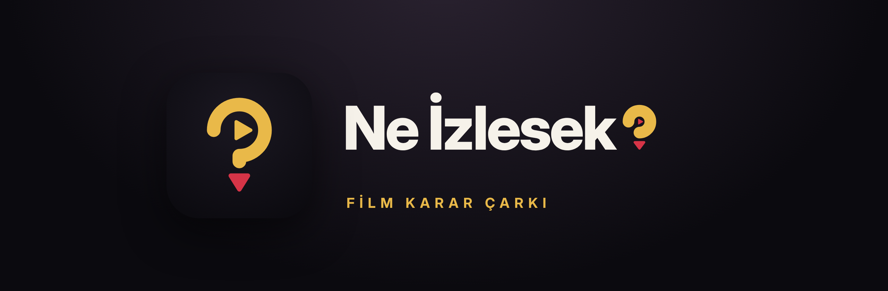

<p align="center">
  
</p>

<p align="center">
  <b>Ücretsiz · Reklamsız · Ticari olmayan</b><br>
  <b>Free · No ads · Non-commercial</b>
</p>

---

## 🇹🇷 Ne İzlesek? nedir?

**Ne İzlesek?**, "bu akşam ne izlesek?" tartışmasını saniyeler içinde bitiren bir Android uygulamasıdır.
Ruh halini ve izlediğin platformları seçersin, karar çarkı döner ve izleyeceğin film belli olur.

- 🎡 **Karar çarkı:** Filtrelere uyan filmler çarka dizilir; çark durduğunda filmin türüne özel sinematik bir açılış sahnesi oynar.
- 🎯 **Tek veto hakkı:** Çıkan filmi beğenmezsen bir kez veto edebilirsin; ikinci karar kesindir.
- 👥 **Ortak oda:** Partnerinle aynı odada filtreleri birleştirip birlikte karar verirsin.
- ⚔️ **Düello modu:** İki film arasında art arda seçim yaparak şampiyonu belirlersin.
- 📋 **Özel listeler, geçmiş ve istatistikler:** Kendi çarklarını oluşturur, geçmiş kararlarını ve tür dağılımını görürsün.

### Ücretsiz ve ticari olmayan kullanım

Bu uygulama **tamamen ücretsizdir** ve **ticari amaç taşımaz**:

- Reklam **yoktur**.
- Uygulama içi satın alma, abonelik ya da ücretli sürüm **yoktur**.
- Bağış ya da başka bir gelir kaynağı **yoktur**.
- Kullanıcıdan hesap açması istenmez; kişisel veri toplanmaz. Tercihler ve geçmiş yalnızca cihazda saklanır.

Film posterleri ve film bilgileri için [TMDB](https://www.themoviedb.org/) API'si, TMDB'nin ticari olmayan kullanım koşullarına uygun şekilde ve atıfla kullanılır.

---

## 🇬🇧 About

**Ne İzlesek?** ("What should we watch?") is a free Android app that ends the nightly
"what should we watch?" debate in seconds. Users pick their mood and streaming platforms,
spin a decision wheel, and get a movie to watch.

### Free, non-commercial use

This app is **completely free** and **non-commercial**:

- **No** advertising.
- **No** in-app purchases, subscriptions or paid tiers.
- **No** donations or any other source of revenue.
- No user accounts and no personal data collection; preferences and history are stored on the device only.

Movie posters and metadata are retrieved from the [TMDB](https://www.themoviedb.org/) API under
TMDB's non-commercial terms, with attribution shown inside the app.

---

## TMDB attribution

This product uses the [TMDB](https://www.themoviedb.org/) API but is not endorsed or certified by TMDB.

---

## Geliştirici notları / Developer notes

Android (Kotlin, Jetpack Compose). Derleme ve test komutları ile mimari için [`CLAUDE.md`](CLAUDE.md) dosyasına bakın.

```bash
./gradlew :app:assembleDebug        # debug APK
./gradlew :app:testDebugUnitTest    # tests
```
